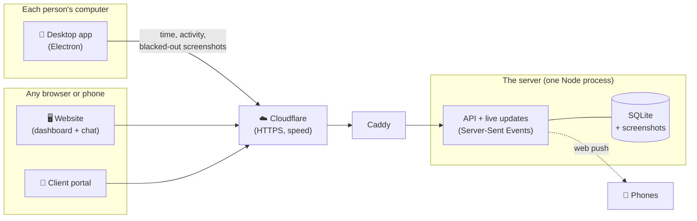

<div align="center">


# Staffwarden

**Time, attendance, tasks, chat, HR and payroll for a remote team, in one place.**
Keeping watch through the night shift.

<br>


Built entirely in-house by **Amplify Media Technologies**.
Formerly *Amplify Tracker*, then *Workhelm*.

</div>

---

## Contents

- [What it is](#what-it-is)
- [Principles](#principles)
- [Everything it does](#everything-it-does)
- [Who sees what](#who-sees-what)
- [How it fits together](#how-it-fits-together)
- [Run it locally](#run-it-locally)
- [Going live](#going-live)
- [Releasing the desktop app](#releasing-the-desktop-app)
- [Developer access](#developer-access)
- [Project layout](#project-layout)
- [Tests](#tests)
- [Brand](#brand)

---

## What it is

Staffwarden replaces Hubstaff, ClickUp and WhatsApp for a company whose team works remotely, mostly on a night shift. Three parts, one server:

| | |
|---|---|
| 🦉 **Desktop app** | What each person runs on their computer. Start, Pause, Resume, Stop. Random screenshots with private windows painted black, an activity meter, boosts, notifications, and updates that install themselves. |
| 🖥️ **Website** | The dashboard for everyone: your day, the team's live status, chat, tasks, time off, pay, the leaderboard, and for managers, HR and the owner everything about running the company. |
| 🤝 **Client portal** | Your clients sign in to see their project: progress, tasks, approvals, files, hours and messages with the team. Never anything about people's time, screenshots or pay. |

---

## Principles

These are rules in the code, not settings.

> **Tracking is visible and consent-based.** Nothing is captured until a person has read and agreed to what is tracked, and they are asked again whenever more would be captured.

- 🔒 **Private stays private.** Messaging apps, password managers, banking, social media, private browser windows and notification pop-ups are painted black on the person's own computer, before a screenshot ever leaves it.
- 🚫 **Which apps and websites people use is never recorded.** Activity is only a count of seconds with keyboard or mouse input. What is typed is never recorded.
- 👀 **People see what is seen about them.** Every change to someone's schedule, tracking or time is shown to them, with who made it. Everyone can see who has HR or developer access.
- ⏸️ **Paused means paused.** No screenshots and no activity while the timer is paused or idle.
- 🧾 **Everything is audited.** Who changed what, and when, in an audit log only the owner reads.

---

## Everything it does

<details open>
<summary><b>⏱️ Time and attendance</b></summary>

- One-click timer in the desktop app, with break reasons (prayer, dinner, short break…) and idle detection
- Shifts that cross midnight, each person's own time zone, half days and different hours on some days
- Attendance (on time, late, absent, on leave), weekly targets and pace
- Timesheets, reports and CSV export
- Missing-time requests and notes on any stretch of the day
- A timer that goes silent is closed at its last sign of life, never padded
</details>

<details open>
<summary><b>📸 Screenshots and activity</b></summary>

- 0 to 3 random screenshots per 10 minutes, set by the owner per company, team or person
- Private windows blacked out on the device (see Principles)
- Activity meter per 10-minute block; "Still there?" nudges when idle
- Screenshots deleted automatically after the retention period
</details>

<details open>
<summary><b>✅ Projects and tasks</b></summary>

- Projects with leads and members, tasks with due dates, review and approval
- Task performance: completion, on time, first-time approval
- Tasks made straight from chat messages
</details>

<details open>
<summary><b>💬 Chat, announcements and boosts</b></summary>

- The company's own chat instead of WhatsApp: everyone, channels, groups, direct messages, replies, mentions, voice messages, GIFs and files
- Announcements people confirm they've read
- **Boost:** the owner's one-tap morale boost, with an animated clip that pops up in the corner of everyone working
- Notifications per device (phone, browser, desktop app) with quiet hours outside the shift
</details>

<details open>
<summary><b>🏆 Leaderboard</b></summary>

- Ranks this week, month or year by **hours worked**, with **activity** alongside, on an animated podium
- The owner and developers choose what it ranks by (hours, activity or points), what it shows and who can see it
- People are told whenever it starts showing more about them
</details>

<details>
<summary><b>👥 HR and payroll</b></summary>

- People's records, documents, time off and leave balances
- Monthly payroll from Staffwarden hours, attendance and time off: Pakistan income tax, allowances, commission, deductions, payslips
- Expenses with receipts and advances, approved by managers and HR
- HR is its own role: records and pay, never screenshots or activity
</details>

<details>
<summary><b>🤝 Client portal</b></summary>

- Clients see their project's progress, tasks, approvals, files, hours against their retainer and meetings
- They message the team; the team can keep notes clients never see
- "See it as the client" preview for the project lead
</details>

<details>
<summary><b>🛠️ Developer access</b></summary>

- Server health, database and backups at a glance
- A notice across the top of every screen for updates or downtime
- Desktop app versions per person; upload a new release from the browser, roll back in one click
- Grouped error reports from the website, the desktop app and the server
- Feature switches (off, a few people, everyone) and test tools: test notifications and boost clips to anyone
</details>

<details>
<summary><b>🎮 Just for fun</b></summary>

- God mode: the owner can turn someone's home into a pixel-art game for a day. Looks only, never a permission.
</details>

---

## Who sees what

| | Employee | Manager | HR | Owner | Developer |
|---|:---:|:---:|:---:|:---:|:---:|
| Their own day, screenshots, pay | ✅ | ✅ | ✅ | ✅ | ✅ |
| Team status (working, on a break, hours today) | ✅ | ✅ | ✅ | ✅ | ✅ |
| Others' screenshots and activity | | their teams | | ✅ | ✅ |
| Records, pay and payroll | | | ✅ | ✅ | ✅ |
| Settings, boosts, roles | | | | ✅ | ✅ |
| Server health, releases, error reports | | | | if switched on | ✅ |

Nobody can read anyone else's direct messages, not even the owner. Developer access is given by the owner only, can't change the owner's account or give the access to anyone else, and everyone is told who has it.

---

## How it fits together



- **Server:** Node 22 with the built-in `node:sqlite`. No npm packages at all. It serves the API, the website and the downloads, and pushes live updates over Server-Sent Events.
- **Website:** plain ES modules, no build step. Pages update in place when something changes.
- **Desktop app:** Electron. Screenshots are taken and blacked out on the device; work waits in an outbox while offline and is sent later.
- **Database upgrades** run by themselves on start, versioned and tested, so a new version never loses data.

---

## Run it locally

Requires **Node 22.5 or later**.

```bash
# the server and the website (no npm install needed)
OWNER_EMAIL=you@company.com OWNER_PASSWORD='a-long-password' npm start
# → http://localhost:3000, sign in as the owner

# the desktop app
cd desktop && npm ci && npm start   # npm ci installs the exact versions in package-lock.json
```

<details>
<summary><b>Settings you can pass when starting</b></summary>

| Variable | Default | |
|---|---|---|
| `PORT` | 3000 | |
| `OWNER_EMAIL` / `OWNER_PASSWORD` | – | the owner account, created on first start |
| `ORG_NAME` | Your company | shown everywhere |
| `SHIFT_START` / `SHIFT_END` | 09:00 / 18:00 | the company default; each person can differ |
| `TZ_OFFSET_MIN` | 300 | company time zone (300 = Pakistan) |
| `WEEKLY_TARGET_MIN` | 2400 | 40 hours |
| `SHOTS_PER_10` | 2 | screenshots per 10 minutes (0 to 3) |
| `IDLE_LIMIT_MIN` | 10 | minutes without input before time shows as idle |
| `RETENTION_DAYS` | 60 | screenshots older than this are deleted |
| `DATA_DIR` | ./data | the database and screenshots |

Everything except the port, the owner sign-in and the data folder can be changed later by the owner under **Settings**.
</details>

---

## Going live

On a fresh Ubuntu server, from the project folder:

```bash
sudo bash deploy/setup.sh staffwarden.com you@company.com     # first time
sudo bash deploy/domain.sh staffwarden.com --cloudflare        # behind Cloudflare
sudo bash deploy/update.sh                                     # every update after that
```

In production, company sign-up needs a mail server (`SMTP_*` in `/etc/workhelm.env`): without one, sign-up stays closed rather than showing the email code on screen.

`setup.sh` installs Node and Caddy (automatic HTTPS), runs Staffwarden as a service that restarts itself, opens only SSH, HTTP and HTTPS, and backs the database up every night (14 days kept, with an optional off-site copy). Data lives in `/var/lib/workhelm`, settings in `/etc/workhelm.env`, logs with `journalctl -u workhelm -f`.

To sell it to other companies, each at its own address with sign-up, plans and Stripe billing, see [docs/service.md](docs/service.md) (`sudo bash deploy/service.sh …`).

> The service, folders and the desktop app's internal name still say *workhelm*, so everyone's sign-in, settings and running timer carried over through the rename.

---

## Releasing the desktop app

```bash
cd desktop
npx electron-builder --mac zip --x64 --arm64 --publish never
npx electron-builder --win nsis --x64 --publish never
```

Name the files `Staffwarden-<version>-mac-Intel.zip`, `Staffwarden-<version>-mac-AppleSilicon.zip` and `Staffwarden-Setup-<version>.exe`, then sign them with the release key:

```bash
node tools/sign-release.js ~/path/to/staffwarden-release-key.pem dist/Staffwarden-*
```

That writes a `.sig` file next to each installer. Upload the installers **and** their `.sig` files on **Developer → Desktop apps** and write what's new. The server refuses an installer without a valid signature, and the desktop app checks the signature again before installing, so a release can't be swapped even by someone with access to the server. Every app offers the update within the hour; the timer can only be started from the newest version. The previous five versions are kept for rolling back.

Only the operator's own company (the platform's default address) can publish or roll back releases. Developers at customer companies see which version is live, but not the upload panel or the server's health details.

The public half of the release key is in `keys/update-key.pub` and in `desktop/package.json` (`workhelm.updateKey`). Apps from before signing install the next update the old way; once on it, they check the signature of every update after that.

> Neither the code-signing key nor the release key ever goes in this repository or on the server. Keep both on your own computer, with a backup somewhere safe: losing the release key means shipping a new app by hand to replace the key.

---

## Developer access

The owner switches it on for someone on the **People** page. It gives the owner's view of everything plus four developer pages:

| Page | |
|---|---|
| **Overview** | server, database, backups, live connections, the newest errors, the notice at the top |
| **Desktop apps** | who runs which version, reminders, releases from the browser, rolling back |
| **Error reports** | grouped by what went wrong, with how often and who it hit; mark fixed or ignore |
| **Switches and tools** | feature switches and test notifications, boost clips and errors |

---

## Project layout

```
server/
  app.js            the HTTP server, sign-in, live updates, downloads
  db.js             the schema and every database upgrade
  routes/           the API, one file per area (timer, chat, payroll, dev, leaderboard…)
  services/         calculations (hours, attendance), notifications, payroll
  test/             the server's tests
web/
  index.html        one page, many views
  js/pages/         one file per page
  js/portal/        the client portal
  css/              styles
desktop/
  main.js           the Electron app
  src/              timer, outbox, screenshots and blackout, updates, notifications
  renderer/         the app's windows
  test/             the desktop app's tests
deploy/             setup, update, domain, backups, Cloudflare
docs/               the logo and images for this page
```

---

## Tests

```bash
npm test
```

Runs the server and desktop tests with Node's built-in test runner: privacy rules (what managers, HR, clients and developers can and can't see), timers across midnight and time zones, payroll and tax, database upgrades from every past version, the client portal, chat, releases and more.

---

## Brand

| | | |
|---|---|---|
|  **Ink** `#1A1238` |  **Violet** `#6B55D6` |  **Lilac** `#C3B3FF` |
|  **Amber** `#F7B544` |  **Moon** `#E9E6F5` |  **Ground** `#F6F5FB` |

**Warden Owl** keeps watch: he blinks and looks around, follows your cursor on the sign-in page, covers his eyes while you type your password, and dozes when nobody needs him. Titles are set in a warm serif; everything else in Instrument Sans.

---

<div align="center">

Made in Islamabad, for the night shift.<br>
© Amplify Media Technologies. All rights reserved.

</div>
